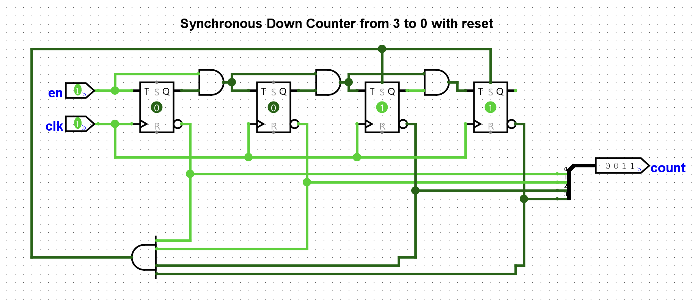
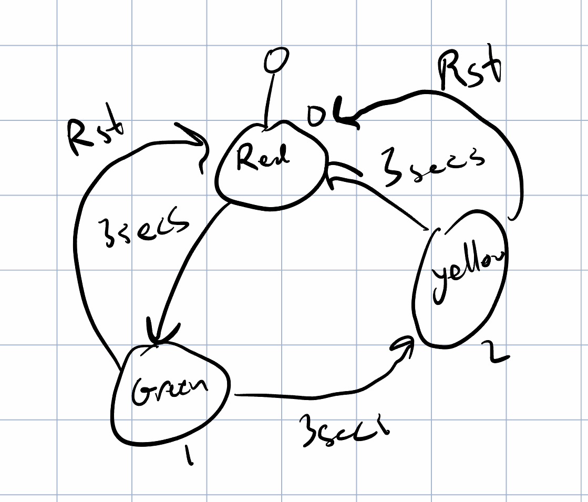
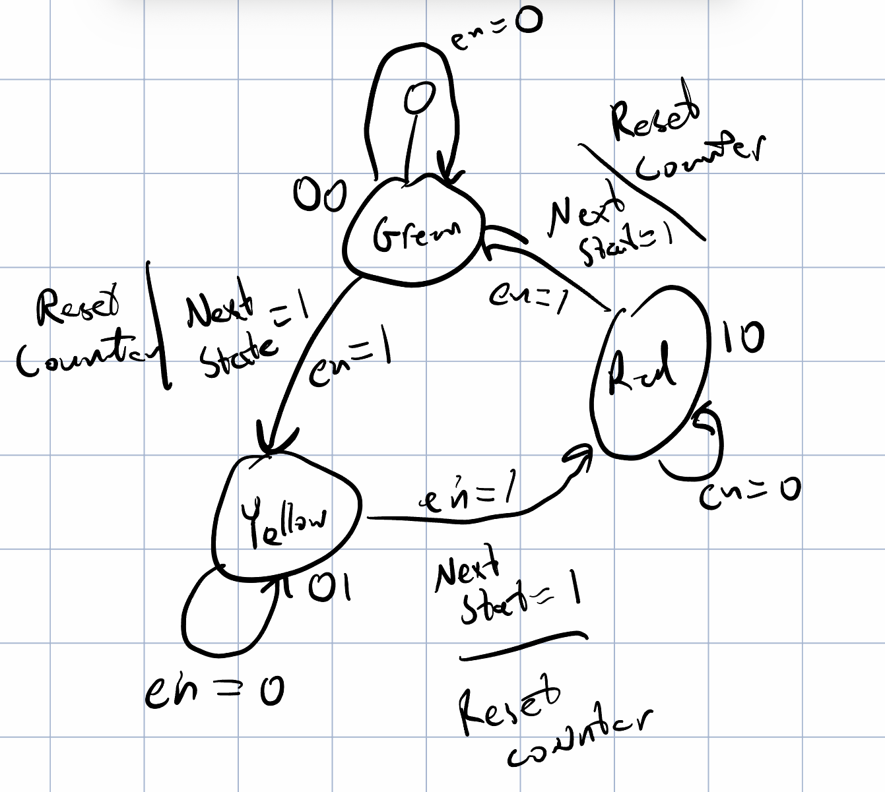
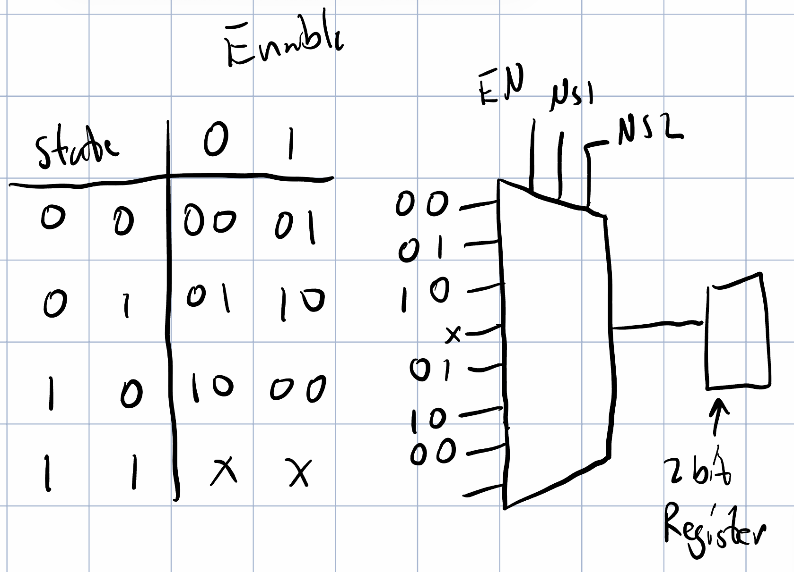
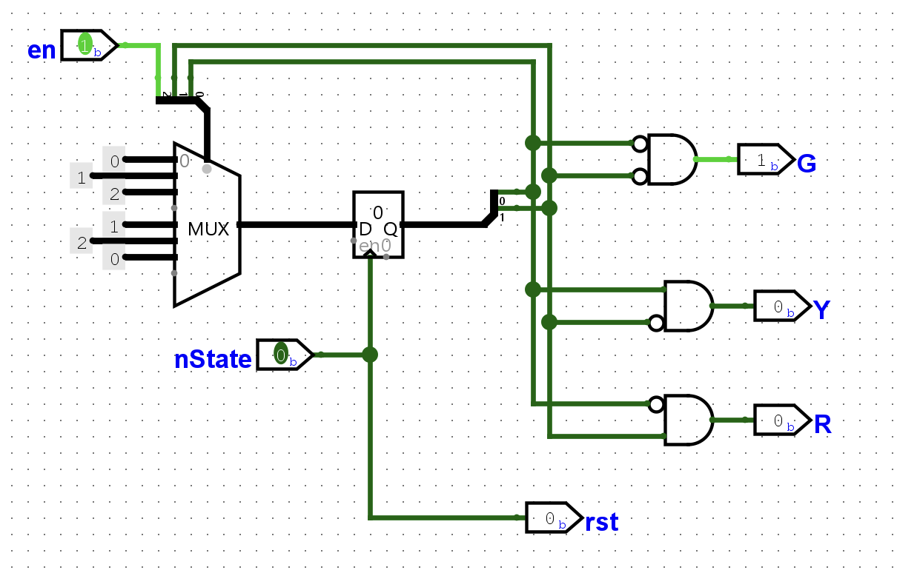
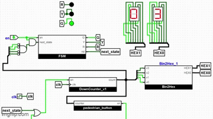

# Lab 07 -- Harrison Knight

## Fixing the down counter

## My first solution for the State Machine

## Fixing the State Machine

I needed to add numbering for each state, which will be held by a state register. Also, I was thinking about the "rst" output incorrectly. I was not thinking of it as an output, but an input. The rst output is actually used to control the resetting of the counter, not the FSM. 

Instead of using 3 seconds as the trigger for changing state, I changed the trigger to en == 1 && nState == 1. This allows the timing to be handled by a different module, like the counter.

## Implementing the State Machine in Logisim

### Designing the MUX

### Final Implementation

## Connecting Everything else

