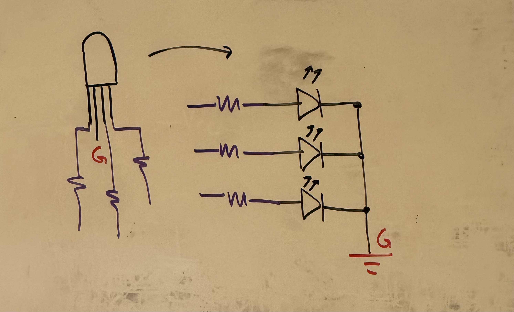
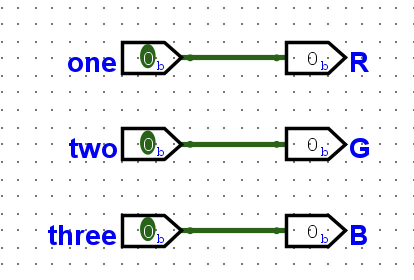
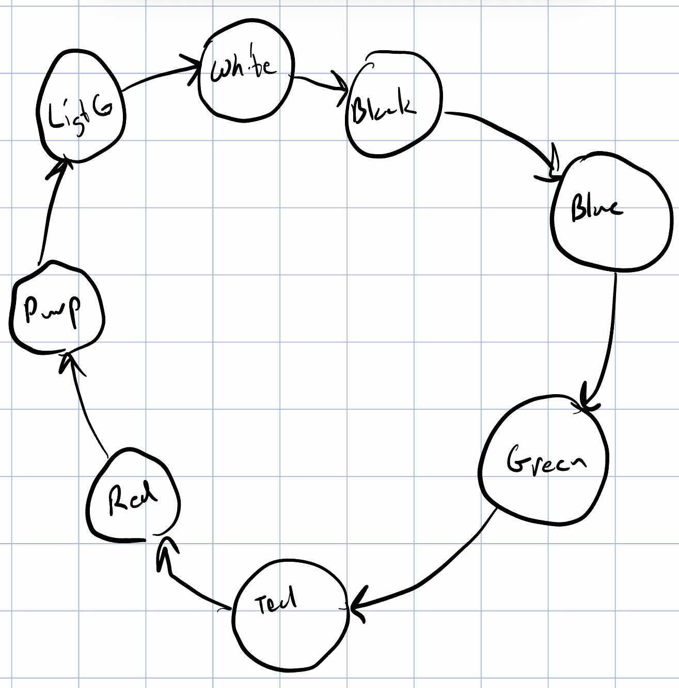
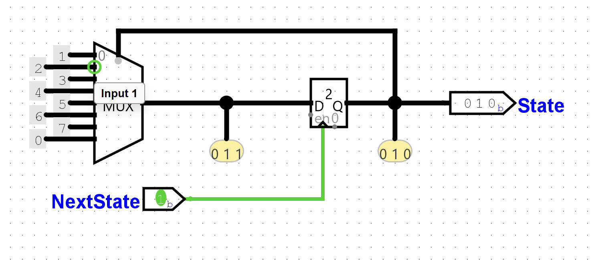
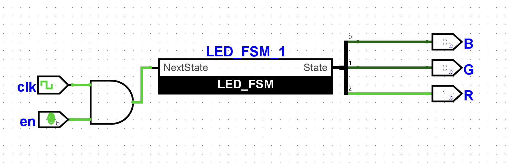
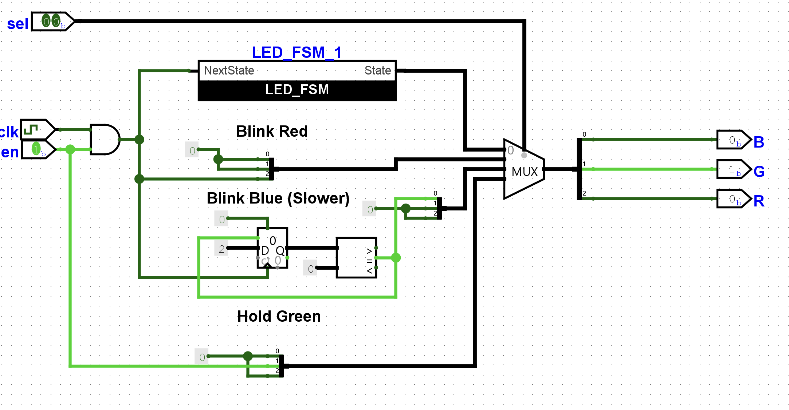

# Lab 08 -- RGB Led

## Wiring 
Here is wiring for the RGB LED:

Each resistor will go to 13, 12, and 11. The longest pin on the LED will go to ground.

## Logisim Inital Logic

We can upload this to the FPGA while mapping inputs one, two, and three to `[2:0] SW`.

## Goal 1: Cycle between 8 different colors at a 1 second rate

I think that the easiest approach will be an FSM with 8 States, that can then go through a decoder to be output as different colors. We can use a down counter to manage the next state timing. We can also use a simple 8 bit counter, but I like the FSM approach because we will use it later on for other goals.

| State No. | R | G | B | Color |
| --------- | - | - | - | ----- |
| 0 | 0 | 0 | 0 | Black |
| 1 | 0 | 0 | 1 | Blue |
| 2 | 0 | 1 | 0 | Green |
| 3 | 0 | 1 | 1 | Teal |
| 4 | 1 | 0 | 0 | Red |
| 5 | 1 | 0 | 1 | Purple |
| 6 | 1 | 1 | 0 | Light green |
| 7 | 1 | 1 | 1 | White |

Figure 1. States Table

We can design the FSM on paper:

And then design it in logisim:

Then, simply add it to main with an enable pin:

## Goal 2: Multiple Patterns with a selct switch, at a different rate

We can kind of just throw stuff in here with each input to the multiplexer being a different pattern. The interesting one is blinking blue, where we use a counter, a loading constant, and a comparator to divide the clock to make it slower. 

| Select Number | Pattern |
| ------------- | ------- |
| 00 | Cycle through 8 Colors |
| 01 | Blink Red (Rate A) |
| 10 | Blink Blue (Rate B) |
| 11 | Hold Green Steady |
