# Digital Design Final Project -- Traffic Light

## Introduction
Our project is to design an intersection that has two traffic lights, and a pedestrian button. We can setup a nicely formatted simulation in logisim, but Dr. Martin provided an html file that acts as a simulation.

    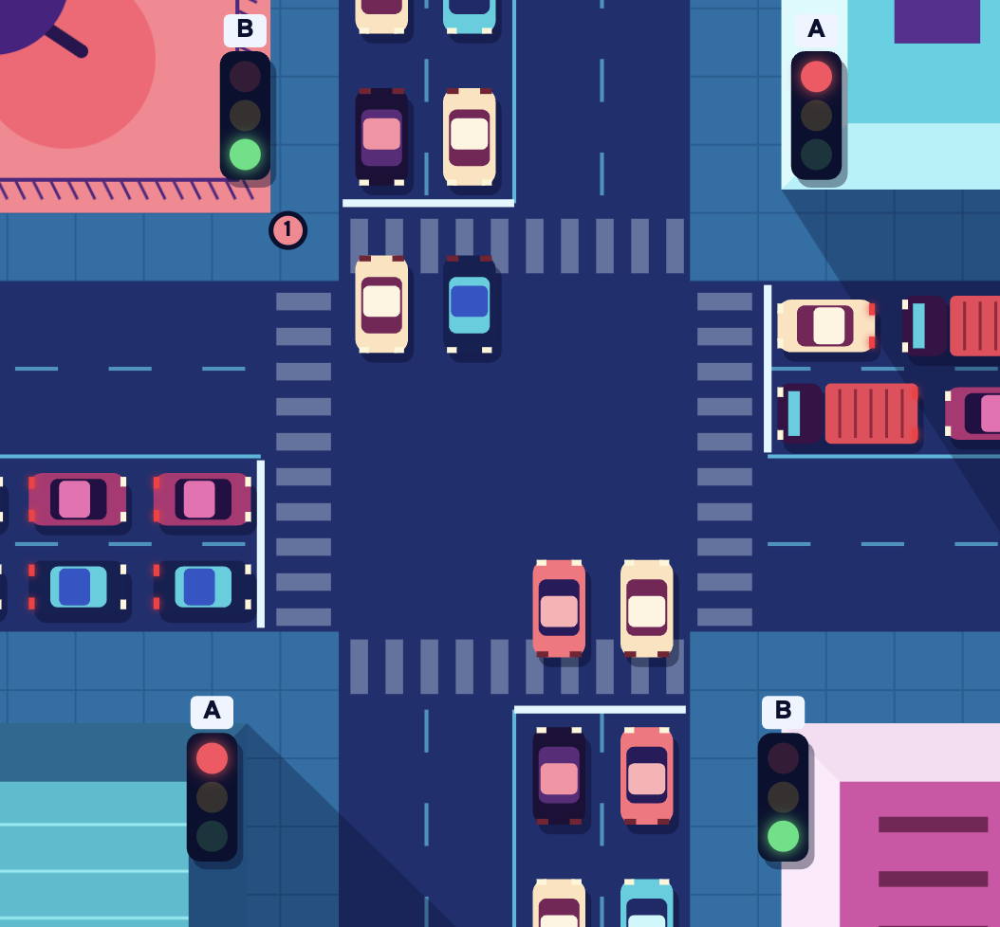

### Logic
The idea is that every three seconds, a change of state will occur. Each of the traffic lights will have opposite initial states (ie. East-West will init. to red, and North-South will init. to green). The catch is that we cant have two yellows at the same time, so we can only allow East-West to go to green after North-South has cycled from green to yellow, and then yellow to red.

### Timing
In the grand scheme of things, at least one change of state will occur every 3 seconds, as long as the pedestrian button is not pressed. If the ped. button is pressed, then the circuit will take the required time to bring both lights to red, and then count down for ten for the pedestrians to cross.

## Starting with just the traffic lights

### Hardware needed

The hardware we need includes pretty much everything we learned about this quarter. Seven segment displays, registers, combinational logic, multiplexers, etc.

### The FSM

For Lab 07, we designed a simple traffic light, that changed states (cycled) every 3 seconds. For this we used a down counter from 3 -> 0 and a 2hz clock. The FSM used was relatively simple, with just three states.

At first, I thought that we could take the simple FSM from lab 7, duplicate it, and simply reverse the order of the states. Then, I saw the problem. We cant have two yellows. Simply reversing the states would cause this. So, instead, we will use one state machine with more states, that never allows these cases: two yellows, two greens, and two reds. The lattermost case is important right now, but in the future when we add the pedestrian button, we will require two reds.

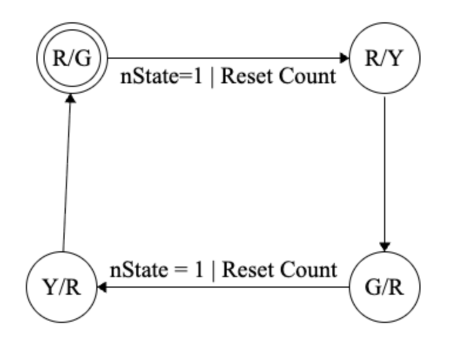

#### Designing this FSM in logisim:

I took a very similar approach to the construction of this FSM as we did during lab 7. I used a multiplexer for each of the 4 states, a state register, and inverters and AND gates to get 4 state outputs (RG, RY, GR, YR).

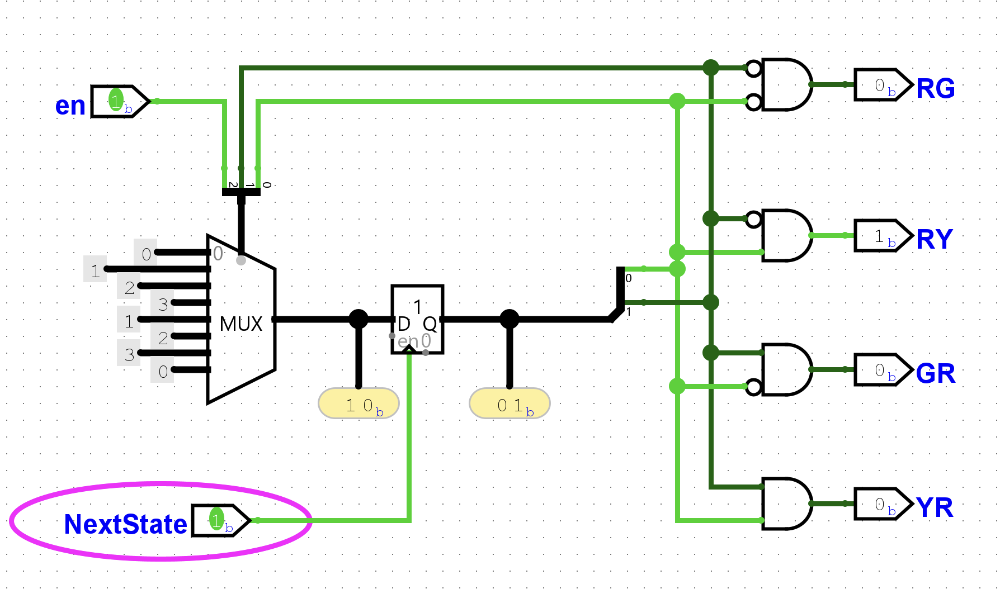

Later, we can use this same logic with a larger MUX to add the pedestrian button states.

## Thinking Through the States Needed

For the full intersection, we need to have the two lights, but also the pedestrian button. For the FSM, we can use the four state used above and then also add to new states: `WALK_A` and `WALK_B`, which will both correspond to two Red-Red states. The difference between them is which light will go green after the ten second walking countdown passes. For example, `WALK_B` might follow Road B's yellow, so road A will go green afterward.

| State  | Binary | Light A | Light B |
| ------ | ------ | ------- | ------- |
| RG     | 000    | Red     | Green   |
| RY     | 001    | Red     | Yellow  |
| GR     | 010    | Green   | Red     |
| YR     | 011    | Yellow  | Red     |
| WALK_B | 100    | Red     | Red     |
| WALK_A | 101    | Red     | Red     |

I found a nice tool online to makea finite state machine with labels and arrows [here](https://fsm-builder.vercel.app/). Here is a visualization of the state machine I designed following the table above:

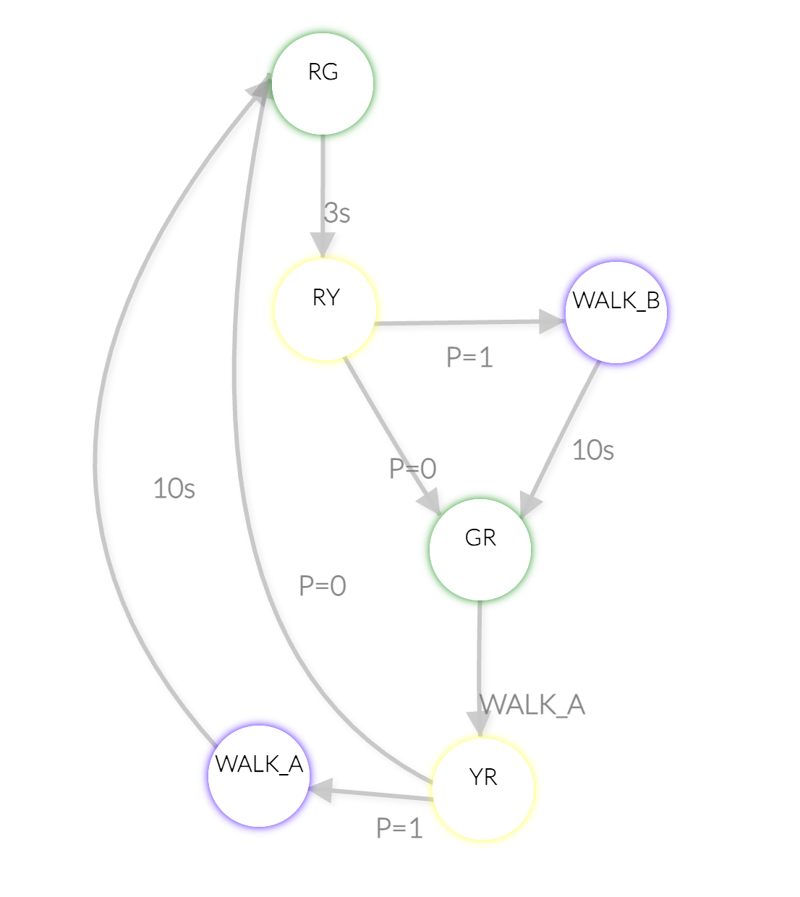

### Logisim FSM for ped button
We can implement this in logisim with an 8 to 1 3 bit mux, and two 2 to 1 muxes with the pedestrian button as the select bit. 

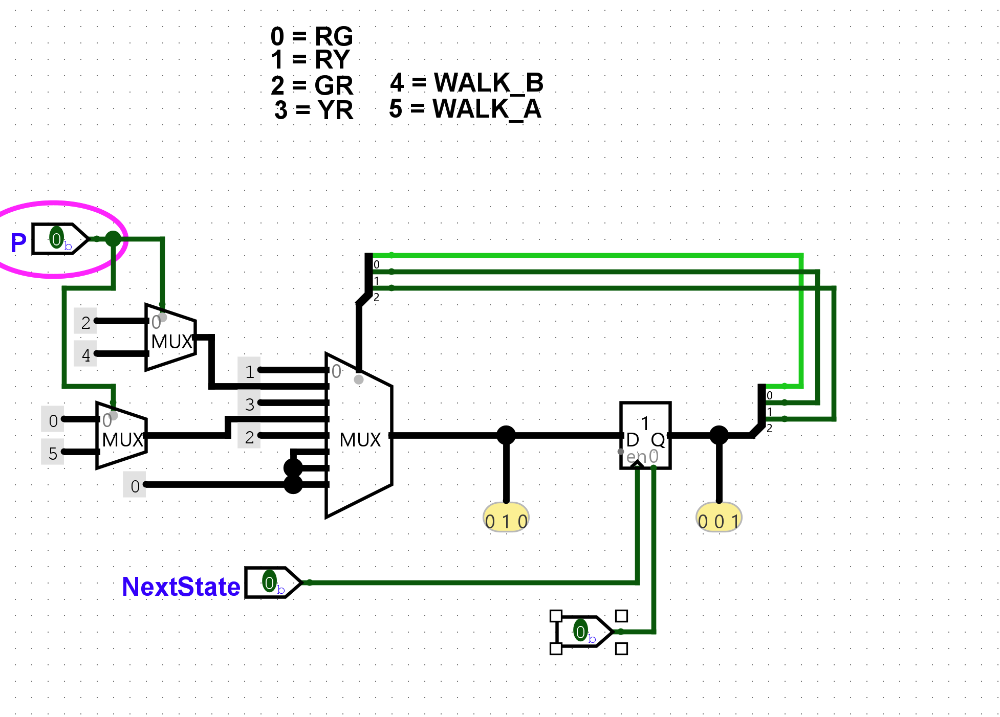

We have not yet added the combinational logic to decode each state into outputs, so lets do that now.

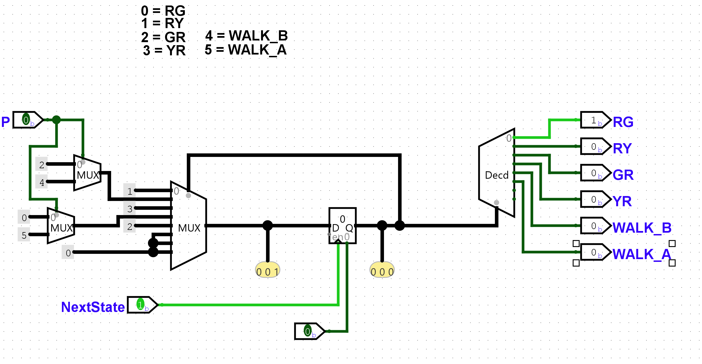

## Counting Logic
This is a nice implementation of the FSM. After this I shifted gears and made the below circuit, with is a down counter that can select between counting down from 10 and counting down from 3. This will be useful between FSM states, and it is usable because we dont ever need to count from 10 or 3 simultaneously. 

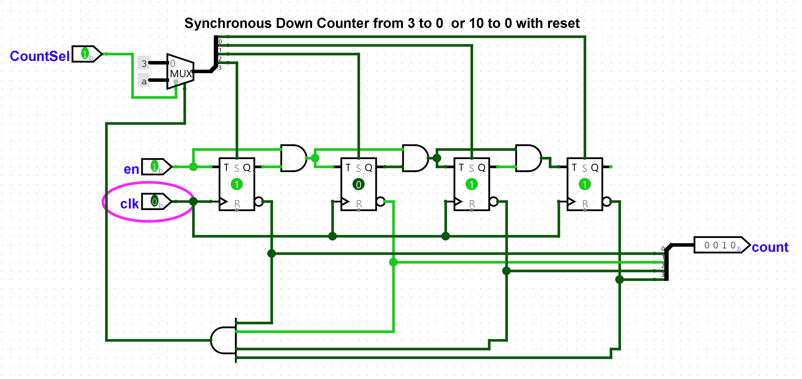

## Latching the Pedestrian Button Request

I realized as I was making the FSM that I would need to find a way to latch the pedestrian button when the following scenario occurs:

1. Road A is green with two seconds remaining. 
2. Someone presses the pedestrian button for a tenth of a second.
3. They release the button.
4. Road A enter the yellow state.
5. The FSM must enter WALK_A, even the button isn't currently pressed.

We already have the logic in the FSM to handle a stored `P` request, so we dont need to change anything there. Instead, we can implement a new module called PedestrianRequest. It can take three inputs and one output:

| Input / Output | Purpose |
| ----- | ------- |
| `Button`| Raw Pedestrian Button |
| `WALK` | HIGH when a walk state is active |
| `Clock` | Clock input |
| `P` | Stored ped request output |

While `WALK = 1`, button presses will be ignored. The latch will be cleared during the pedestrian walking phase, and a button press cannot produce another request directly afterward.

At this point, I realized I was making a mistake. For our project, we will be using a clock divider through logisim's synthesis. If we were writing this in verilog using the MAX10's 50MHz clock directly, we would be able to create multiple clock frequencies with different dividers. Since we only have the one 2Hz clock, we run into an issue when using a D flip-flop and a clock input to store a button press because a button press can be shorter than the period of the clock. So I had to think about another way to do think to do this. I remembered the SR-latch from class, and decided it would be a good option.

Let's change the inputs and outputs so we can have an asynchronous SR-latch.

| Input / Output | Purpose |
| ----- | ------- |
| `Button`| Raw Pedestrian Button |
| `WALK` | HIGH when a walk state is active |
| `P` | Stored ped request output |

We want the circuit to follow this behavior:

| Button | WALK | P |
| ------ | ---- | - |
| 0 | 0 | Holds Previous |
| 1 | 0 | 1 |
| 0 | 0 | 1 |
| 0 | 1 | 0 |
| 1 | 1 | 0 |

This isn't necessarily a truth table, but rather a way to organize my thoughts on how the circuit should operate. This is what I came up with:

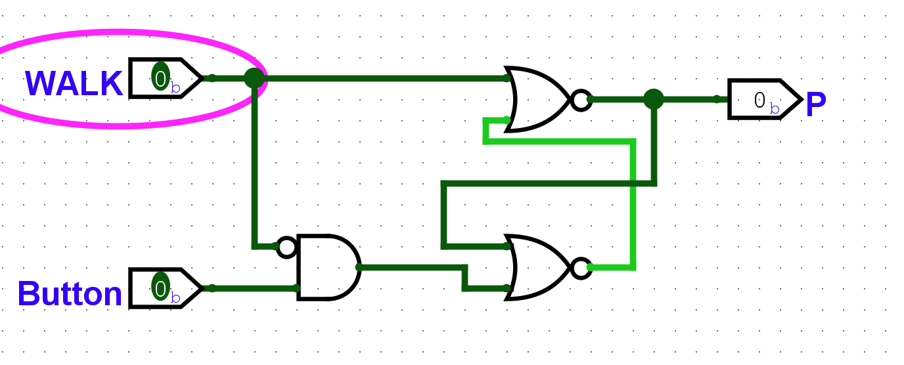

This gives us the correct behavior for latching. 

## Traffic Light Decoder -- A quick pitstop

I decided earlier that I would not further decode the FSM outputs *inside* of the FSM module than I needed to, so I will need to build a TrafficLightDecoder module that can give the correct outputs the Logisim RGB LEDs we will use to simulate the traffic lights.

This is pretty simple, all we need is some simple combinational logic. Logisim has a cool tool that allows us to input a truth table, if we supply the inputs and outputs. We just have to make sure we keep in mind that the LEDs we are using only have Red, Green, and Blue digital inputs, so for yellow, we will have to make sure to connect the Red and Green inputs in the main module. Here is the truth table:

| State | RA | YA | GA | RB | YB | GB |
| ----- | -- | -- | -- | -- | -- | -- |
| RG    |  1 |  0 |  0 |  0 |  0 |  1 |
| RY    |  1 |  0 |  0 |  0 |  1 |  0 |
| GR    |  0 |  0 |  1 |  1 |  0 |  0 |
| YR    |  0 |  1 |  0 |  1 |  0 |  0 |
| WALK_A|  1 |  0 |  0 |  1 |  0 |  0 |
| WALK_B|  1 |  0 |  0 |  1 |  0 |  0 |

Because the FSM only produce one state at a time, we can just use OR gates. The WALK output can be used later in the main module to select the counters maximum value.

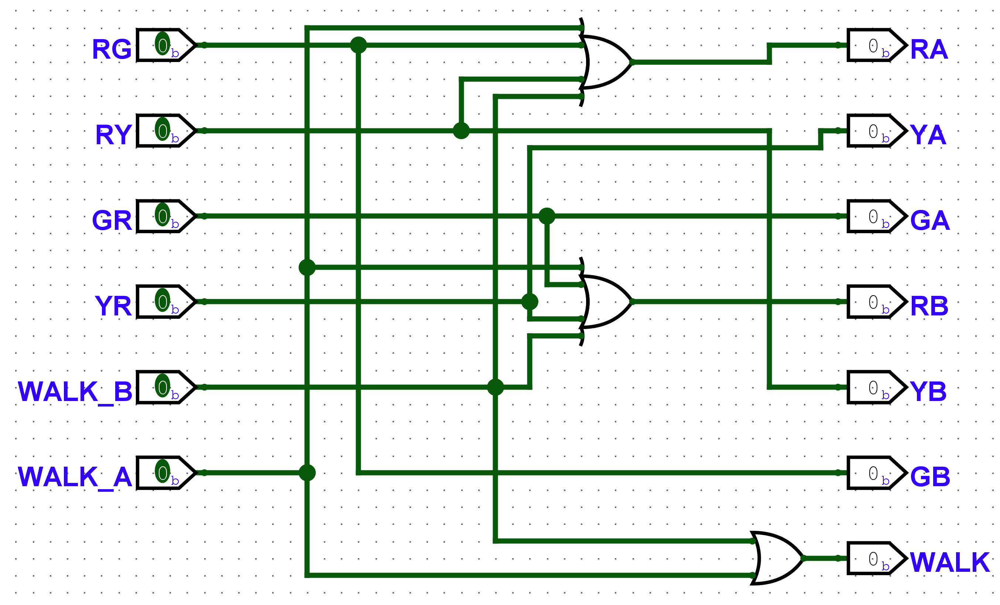

## Putting it all together!

Quick sidenote, as I was throwing it all together, I noticed that a asynchronous reset would be helpful for the pedestrian request, so I implemented that:

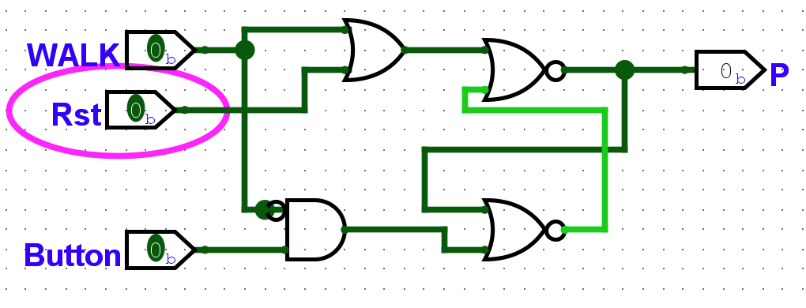

The "putting together" of this project is pretty self explanatory, so I have simply attached a large screenshot below. I have also embedded a YouTube showing it working on Logisim, and another one showing it working on the DE10 Lite.

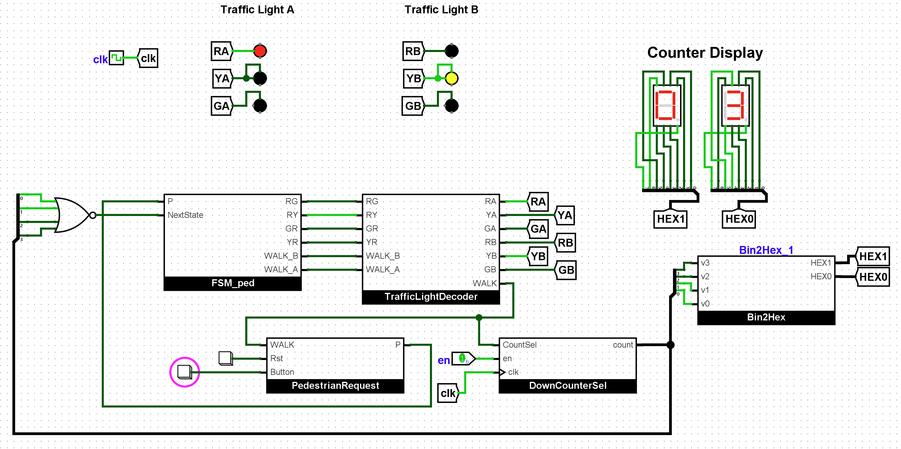

## Project Conclusions and Thoughts

I thought that this project was really interesting. I thoroughly enjoyed working on it. It was really cool to see it come to life in the way that it did. I truly believe that the modular way that I completed this project made the final main module very pretty. Everything has a purpose, and it is simply named enough that one can under what each piece is doing, without having to look terribly far into the submodules. 

I was happy when I figured out that the decoding of the FSM was much simpler than I expected because of the One-Hot logic of the FSM. When I connected the FSM module to the decoder module, I felt a great feeling of satisfaction. The pedestrian request module's latching logic is seamless, and it even provides the tools for the user to cancel the request if needed, as well as initializing the circuit. Also, it provide the logic to disallow a second walk request being initiated during a current walk state.

The selectable counter is really cool, and simplifies the main module considerably. I should point out that the selectable counter relies completely on the value of either of the walk states. This allows for a nice transition between standard cycling states and walking states, while taking advantage of the fact that we are only using one maximum value of the counter at a time.

I am proud, also, that I was able to complete this project without the use of AI, and that I was able to use solely what we learned in . I loved being a part of it, and it opened up a whole new world for me in terms of my understanding of hardware and computers. I was inspired enough to go learn (and continuing to learn) Verilog, and do some awesome projects with it. 