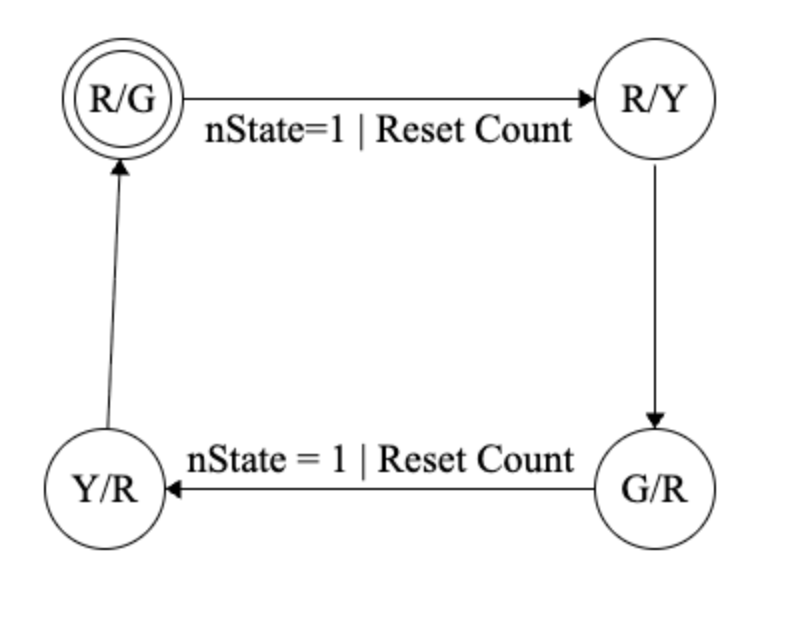

# Digital Design Final Project -- Traffic Light

## Introduction
Our project is to design an intersection that has two traffic lights, and a pedestrian button. We can setup a nicely formatted simulation in logisim, but Dr. Martin provided an html file that acts as a simulation.

    

### Logic
The idea is that every three seconds, a change of state will occur. Each of the traffic lights will have opposite initial states (ie. East-West will init. to red, and North-South will init. to green). The catch is that we cant have two yellows at the same time, so we can only allow East-West to go to green after North-South has cycled from green to yellow, and then yellow to red.

### Timing
In the grand scheme of things, at least one change of state will occur every 3 seconds, as long as the pedestrian button is not pressed. If the ped. button is pressed, then the circuit will take the required time to bring both lights to red, and then count down for ten for the pedestrians to cross.

## Starting with just the traffic lights

### Hardware needed

The hardware we need includes pretty much everything we learned about this quarter. Seven segment displays, registers, combinational logic, multiplexers, etc.

### The FSM

For Lab 07, we designed a simple traffic light, that changed states (cycled) every 3 seconds. For this we used a down counter from 3 -> 0 and a 2hz clock. The FSM used was relatively simple, with just three states.

At first, I thought that we could take the simple FSM from lab 7, duplicate it, and simply reverse the order of the states. Then, I saw the problem. We cant have two yellows. Simply reversing the states would cause this. So, instead, we will use one state machine with more states, that never allows these cases: two yellows, two greens, and two reds. The lattermost case is important right now, but in the future when we add the pedestrian button, we will require two reds.

